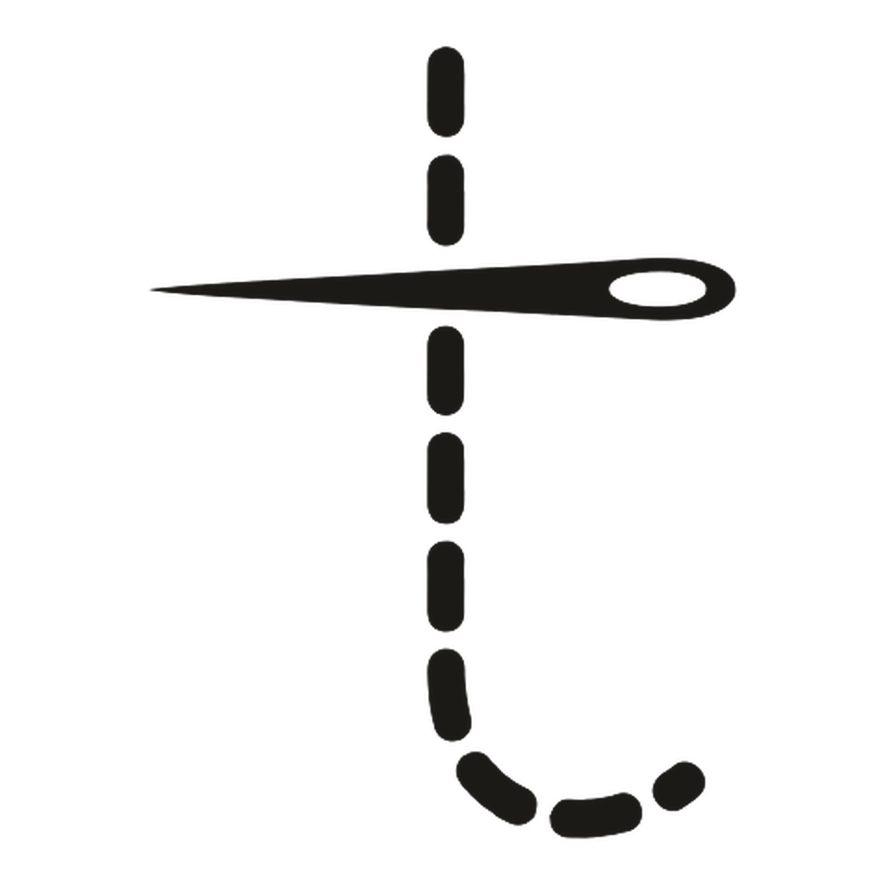

# Tailor

Tailor is your personal stylist inside Claude and ChatGPT. Ask for clothes in your own
words, and Tailor searches real shops and shows the pieces as cards, with photos,
prices and a link to buy on the retailer's own site.

## What it covers

| Country | Stores | Prices in |
| --- | --- | --- |
| South Africa | H&M, Cotton On, Zara, Mango | Rand (R) |
| United States | Zara, Cotton On | US dollars ($) |
| United Kingdom | Zara, Cotton On | Pounds (£) |

Women's, men's, kids' and baby clothes. Prices are never converted, and retailers ship
only within their own country, so Tailor searches the shop where you live.

## What's in the plugin

- **The Tailor connector** (`https://mcp.tailor.ai/mcp`), with six read-only tools:
  search products, find similar products, tailor a product ("same, but in navy"),
  show a curated set of products, get one product's details, and a catalogue overview.
  Results appear as cards with **Tailor**, **Similar** and **Buy** buttons.
- **Skills** that teach the assistant how to use it well:
  - `build-an-outfit`: a complete look for an occasion, dress code or budget
  - `capsule-wardrobe`: a mix-and-match set for a trip or a new season
  - `find-a-cheaper-version`: look-alikes for less, at another store or on sale

## Use it

Install the plugin, connect Tailor when asked (no account or sign-in), then ask:

- "I'm in South Africa. Find me a white linen shirt for men under R600."
- "I need an outfit for a summer wedding in London: a dress, shoes and a bag, about
  £150 in total."
- "Pack me a 5-day capsule wardrobe for New York in autumn, women's, under $300."
- "Show me cheaper coats that look like that one."

Say where you shop and who it's for, and describe what you want the way a product page
would. Full docs and tips: <https://www.tailor.ai/docs>.

## Data and privacy

The skills are instructions only: they run no code and send nothing themselves. The
connector sends the search requests your assistant makes (search text and filters such
as country, department, store and price) to `mcp.tailor.ai`, operated by Light Bulb
Research (Pty) Ltd. Tailor never sees your conversation, name or account.

Tailor logs those searches, without your IP address or identity, to improve results.
Product links go through `www.tailor.ai/go/…`, which records the click (with a
daily-rotating hash of your IP address, never the address itself) and redirects you to
the retailer. Logs are deleted after two years. Tailor has no accounts and sets no
cookies.

- Privacy policy: <https://www.tailor.ai/privacy>
- Terms of service: <https://www.tailor.ai/terms>

Tailor can't buy anything, see your orders or sign in to a store. You buy on the
retailer's site, and stock and prices can change, so the retailer's page is always the
final word.

## Support

Questions, bugs, or a store you'd like added: <tailor@lightbulbresearch.com>.

## For developers

This one folder is both a Claude plugin and an OpenAI (ChatGPT and Codex) plugin:

| File | Used by |
| --- | --- |
| `.claude-plugin/plugin.json`, `.mcp.json` | Claude (claude.ai, Cowork, Claude Code) |
| `plugin.json`, `mcp.json` | OpenAI, in the Agent Plugins format |
| `skills/`, `assets/`, `README.md`, `LICENSE` | Both |

Anthropic's directory reads this repository directly. For OpenAI, build the upload with
`scripts/build-openai-zip.sh`, which writes `dist/tailor-<version>.zip`. Keep `version`
the same in both manifests; `scripts/check.sh` checks that and validates the JSON.

## License

MIT, see [LICENSE](LICENSE).
